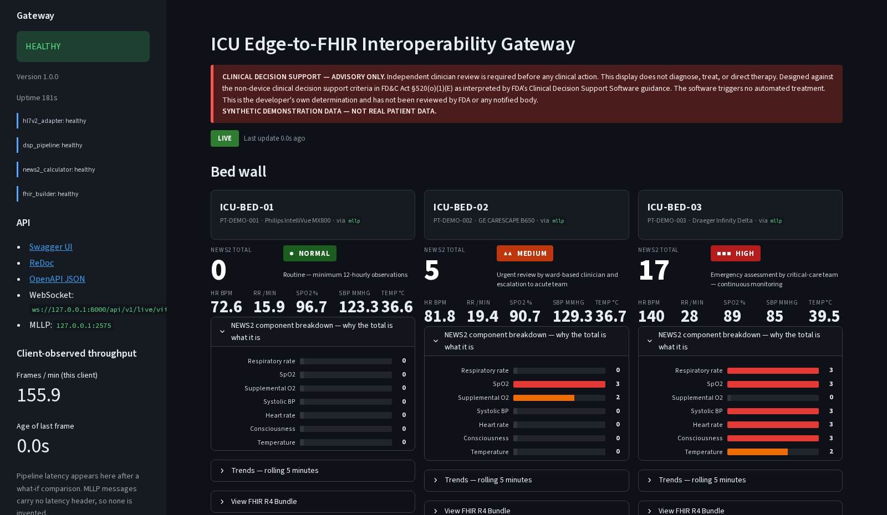
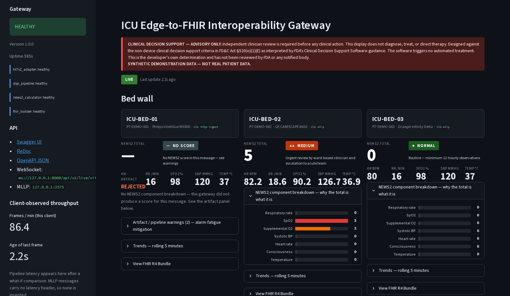
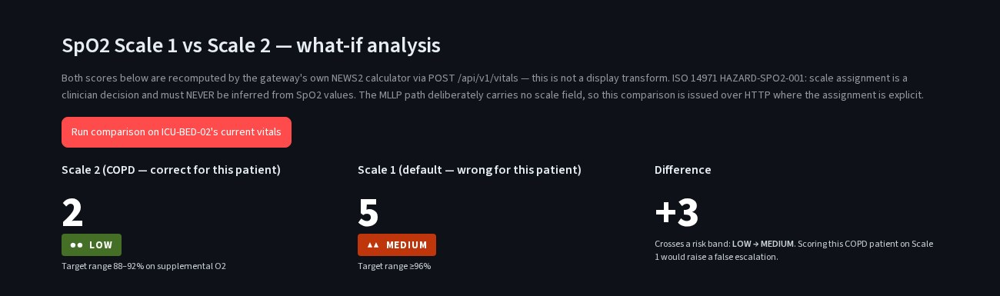
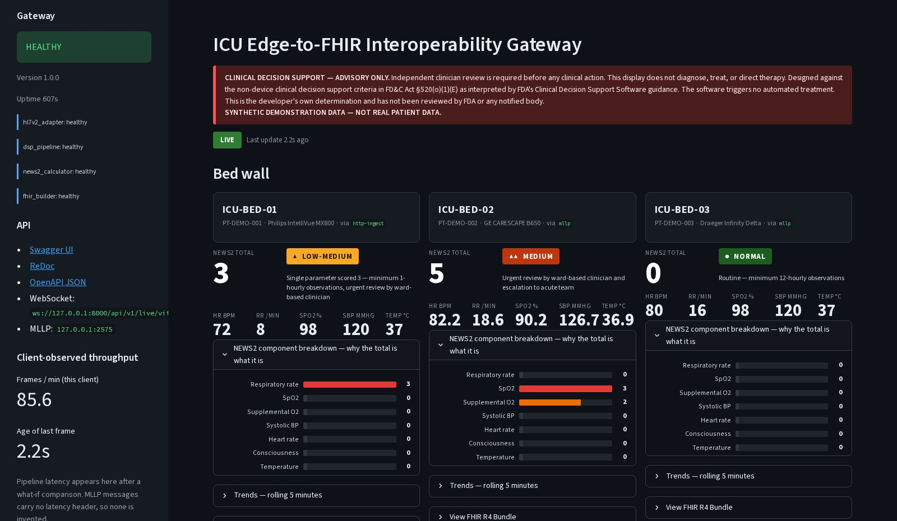

# ICU Edge-to-FHIR Interoperability Gateway

[](https://github.com/abouelre-maker/ICU-Edge-Gateway/actions/workflows/ci.yml)
[](LICENSE)


An open-source research implementation of an edge gateway that converts ICU bedside monitor
data (HL7 v2.x) into HL7 FHIR R4 resources, rejects physiologically implausible values and
waveform artifacts, and computes the National Early Warning Score 2 (NEWS2) deterministically.
The software is developed under IEC 62304 software life-cycle practices and ISO 14971 risk
analysis, and the full design and risk documentation is published with the code.

> **Research software only.** This is not a medical device. It is not FDA-cleared, not
> Health Canada-licensed, not clinically validated, and must not be used for clinical
> decisions or patient care. All data in this repository is synthetic. This statement
> describes the intended use and is a disclaimer; it does not add restrictions to the
> Apache-2.0 license.



## Why this project exists

Many ICUs still run bedside monitors that speak only HL7 v2.x, often with vendor-specific
codes, while modern clinical systems expect FHIR R4. Raw monitor feeds also contain
artifacts (lead-off events, motion, transient sensor faults) that inflate early-warning
scores and contribute to alarm fatigue. This repository is a reference implementation for
studying three linked questions in one open, testable codebase:

1. How can multi-vendor HL7 v2.x vital-sign streams be mapped to standard FHIR R4
   Observations (LOINC, SNOMED CT, UCUM) without silent data loss?
2. How much can simple, deterministic signal-quality controls (physiological bounds,
   notch and bandpass filtering, Hampel outlier rejection) reduce false early-warning
   scores caused by single bad samples?
3. What does traceable, safety-oriented engineering evidence (requirements, hazards,
   tests) look like for clinical decision support software at the edge?

It is intended for researchers, students and engineers in biomedical engineering, health
informatics and clinical decision support who want a working baseline to read, reproduce,
critique and extend.

> **Regulatory status: draft, not determined.** The documents in this repository record an
> engineering analysis only. The software's FDA classification has not been determined; do
> not treat any comment or label in the code that mentions "FDA CDS Non-Device Exemption" as
> settled. See
> [docs/REG-001_Intended_Use_and_CDS_Exemption_Draft.md](docs/REG-001_Intended_Use_and_CDS_Exemption_Draft.md)
> and [regulatory/findings/REG-CITATION-001.md](regulatory/findings/REG-CITATION-001.md).

---

## What this does

1. **Ingests** vital sign data from ICU bedside monitors — either raw HL7 v2.x ORU^R01
   messages (`POST /api/v1/ingest`) or pre-normalized JSON (`POST /api/v1/vitals`).
2. **Parses** scalar vitals (heart rate, respiratory rate, SpO₂, systolic/diastolic BP,
   temperature, AVPU consciousness, supplemental O₂) across five vendor dialects (Philips
   IntelliVue, GE CARESCAPE, Dräger Infinity, Mindray Beneview, Nihon Kohden) plus a
   LOINC-fallback generic path.
3. **Parses continuous waveform channels** (ECG, plethysmograph, etc. via HL7 NA/ED OBX
   segments, including Base64-encoded ED payloads) and runs them through a DSP
   artifact-rejection pipeline: 50/60 Hz dual-notch filtering → vital-sign-specific
   Butterworth bandpass filtering → Hampel-filter motion-artifact rejection.
4. **Calculates NEWS2** (RCP 2017 algorithm) total score and seven per-parameter
   sub-scores, from **scalar vitals only** — waveform data is architecturally and
   test-guarded from ever feeding the score (`TestWaveformNeverFeedsNews2Score`).
5. **Emits a FHIR R4 Bundle** — NEWS2 Observation with per-component sub-observations,
   individual vital-sign Observations, and cleaned waveform data — with an explicit,
   machine-readable `X-CDS-Advisory-Only: true` marker on every response. No automated
   clinical action is ever triggered by this software.

## Methods summary

| Stage | Method | Key parameters (source) |
|---|---|---|
| Plausibility | Physiological bounds check on every numeric value; NaN and ±Inf rejected | HR 20–250 bpm, RR 3–60 /min, SpO₂ 50–100 %, SBP 40–300 mmHg, DBP 20–200 mmHg, temperature 28–45 °C, supplemental O₂ flag 0–1 (`src/domain/services/artifact_rejector.py`) |
| Mains interference | IIR notch filters at 50 Hz and 60 Hz, zero-phase (`filtfilt`) | Q = 2.0 |
| Band limiting | Butterworth bandpass per signal type, zero-phase | order 3; e.g. ECG/HR 0.5–40 Hz, respiration 0.1–1.0 Hz, pleth 0.5–5 Hz |
| Motion artifact | Hampel filter (sliding median, MAD-scaled threshold) | window radius 5, threshold 3 × 1.4826 × MAD |
| Risk score | NEWS2 per RCP 2017, including SpO₂ Scale 1 vs Scale 2 (hypercapnic respiratory failure) and AVPU/new confusion | `src/domain/services/news2_calculator.py`; waveform data never feeds the score (enforced by `TestWaveformNeverFeedsNews2Score`) |
| Output | FHIR R4 Bundle: NEWS2 Observation with per-parameter components, vital-sign Observations, cleaned waveform data, audit notes for rejected values | `src/infrastructure/fhir/` |

Each NEWS2 boundary test in `tests/regulatory/` is traceable to a specific cell of the RCP
2017 scoring table. Hazards are tracked in
[docs/RMF-001_Risk_Management_File.md](docs/RMF-001_Risk_Management_File.md) and linked to
requirements and tests in
[docs/RTM-001_Requirements_Traceability_Matrix.md](docs/RTM-001_Requirements_Traceability_Matrix.md).

### What the methods look like in practice

All screenshots come from the live demonstration stack (`run_demo.sh`) using synthetic data.

| Artifact rejection | SpO₂ Scale 1 vs Scale 2 | Single-parameter rule |
|---|---|---|
|  |  |  |
| An out-of-range heart rate (450 bpm) is rejected and the score is withheld, instead of producing a false HIGH alert. | The same readings score 2 (LOW) on Scale 2 and 5 (MEDIUM) on Scale 1, showing why scale assignment must be a clinical decision. | A single parameter scoring 3 escalates the patient even though the total is only 3. |

## Architecture

Clean Architecture / hexagonal layering. Layer boundaries are documented against
IEC 62304 §5.3 (software architectural design) in comments throughout the codebase:

```
┌─────────────────────────────────────────────────────────────────────┐
│  api/v1/          FastAPI routers — HTTP adaptation only             │
│    ingest.py         POST /api/v1/ingest  (raw HL7 v2.x)             │
│    vitals.py         POST /api/v1/vitals  (normalized JSON)          │
│    health.py         GET  /health         (liveness/readiness)       │
├─────────────────────────────────────────────────────────────────────┤
│  domain/           Pure clinical logic — no I/O, no framework deps   │
│    entities/          VitalSignSample, PatientContext, NEWS2Score…   │
│    services/                                                         │
│      artifact_rejector.py    DualNotch / Bandpass / Hampel filters   │
│      signal_processor.py     4-stage DSP pipeline orchestrator       │
│      news2_calculator.py     RCP 2017 NEWS2 scoring algorithm        │
│      vitals_orchestrator.py  Top-level analysis entry point          │
├─────────────────────────────────────────────────────────────────────┤
│  infrastructure/   Adapters to the outside world                     │
│    adapters/hl7v2_adapter.py     HL7 v2.x → domain entities          │
│    fhir/                          domain entities → FHIR R4 resources│
├─────────────────────────────────────────────────────────────────────┤
│  config.py          CORS_ALLOWED_ORIGINS-driven, fail-closed CORS    │
│  main.py             FastAPI app factory, exception handlers, ASGI   │
└─────────────────────────────────────────────────────────────────────┘
```

## API Reference

| Method | Path | Purpose |
|---|---|---|
| `GET` | `/health` | Liveness/readiness probe |
| `POST` | `/api/v1/ingest` | Accepts a raw HL7 v2.x ORU^R01 message body, returns a FHIR R4 Bundle |
| `POST` | `/api/v1/vitals` | Accepts pre-normalized JSON vital signs, returns a FHIR R4 Bundle |
| `GET` | `/docs` | OpenAPI (Swagger) interactive documentation |
| `GET` | `/openapi.json` | OpenAPI schema |

`/api/v1/ingest`, `/api/v1/vitals` and the live WebSocket require an API key
(`Authorization: Bearer <key>`; the WebSocket also accepts `?access_token=<key>`). Keys come from
`GATEWAY_API_KEYS` (comma-separated, each at least 32 characters). The gateway refuses to start
without them; it never falls back to open access. `/health` stays open for probes.

Every clinical response carries an `X-CDS-Advisory-Only: true` header and a matching FHIR
extension — this software never initiates automated treatment.

## Quickstart

```bash
python -m pip install -r requirements.txt -r requirements-dev.txt
```

Run the test suite:

```bash
pytest --cov=src
```

Run the server locally:

```bash
export CORS_ALLOWED_ORIGINS="http://localhost:3000"   # required in production; see below
export GATEWAY_API_KEYS="$(python -c 'import secrets; print(secrets.token_urlsafe(32))')"
python -m uvicorn main:app --app-dir src --host 0.0.0.0 --port 8000
```

Then visit `http://localhost:8000/docs` for interactive API documentation, or `/health` for
a liveness check.

**`CORS_ALLOWED_ORIGINS` is mandatory to set explicitly for any non-local deployment.** If
unset, the gateway falls back to a `http://localhost:3000` dev default; if set to `*`, the
gateway refuses to start ([src/config.py](src/config.py) — HAZARD-CORS-001 mitigation).

For containerized deployment, see the multi-stage `Dockerfile` (Alpine 3.19, non-root,
CI fails the build if the image exceeds 400 MB) and [docs/DEPLOYMENT_RUNBOOK.md](docs/DEPLOYMENT_RUNBOOK.md) for the
full step-by-step procedure.

## Technical Demo

`scripts/demo_run.sh` runs a single reproducible, real-pipeline demo on top of the
**existing** `docker-compose.yml` stack (mock control plane + gateway + HL7 monitor
simulator, defined in `docker-compose.yml`). It is not a
mockup: every value it prints comes from the actually-running gateway container, over a
real MLLP TCP socket and a real WebSocket connection — no simulated or hardcoded output.

```bash
./scripts/demo_run.sh
```

Requires Docker with Compose v2, `curl`, and a Python interpreter with `websockets`
installed (`pip install -r requirements-dev.txt`).

**What it does, and what a viewer is watching at each step:**

1. **Brings up the stack** (`docker compose up -d`) and waits for `GET /health`. This is
   the same mock control plane + gateway + `hl7-monitor-simulator` sidecar described in
   [`docker-compose.yml`](docker-compose.yml) — nothing demo-specific is started.
2. **Injects one HL7 v2.x ORU^R01 message** over the gateway's real MLLP listener (port
   2575), the same protocol and framing the `hl7-monitor-simulator` sidecar already uses
   continuously in the background. The message deliberately carries **two** Heart Rate
   (LOINC 8867-4) readings for the same patient: a **450 bpm artifact spike** — outside
   the `[20, 250]` physiological bound enforced by
   [`artifact_rejector.py`](src/domain/services/artifact_rejector.py) — followed one
   second later by a corrected, physiologically valid 82 bpm reading. *Why it matters:*
   this is what a lead-off event, motion artifact, or transient sensor glitch looks like
   on a real monitor feed — a single bad sample must not silently corrupt a clinical
   score.
3. **Shows the real gateway log output** for that message (`docker compose logs`,
   filtered to this run's unique patient ID) — the structlog lines emitted by
   [`vitals_orchestrator.py`](src/domain/services/vitals_orchestrator.py) and
   [`mllp_listener.py`](src/infrastructure/streaming/mllp_listener.py) as the message is
   actually processed, including `warning_count` (DSP flagged one artifact) and the
   computed `total_score`. *Why it matters:* the rejection is visible in the same audit
   log a real operations/clinical-engineering team would review — not just asserted by
   this script.
4. **Shows the resulting NEWS2 score.** Because
   [`news2_calculator.py`](src/domain/services/news2_calculator.py) only ever scores the
   most recent *within-bounds* sample per vital-sign type, the 450 bpm spike is excluded
   and the score reflects the corrected 82 bpm reading (NEWS2 total 0, risk `NORMAL`).
   *Why it matters:* had the spike NOT been rejected, `_score_heart_rate()` would have
   scored it 3 — the most severe pulse-rate band — a **false critical-risk alert**
   generated from a single bad sample, not a real deterioration. Artifact rejection is
   what prevents that false score from ever reaching a clinician.
5. **Shows the resulting FHIR R4 Bundle** — the same standards-based output
   ([`bundle_assembler.py`](src/infrastructure/fhir/bundle_assembler.py)) any downstream
   EHR or CDS system would receive, including the rejected-artifact note as a
   `Bundle.note` / `OperationOutcome` audit entry rather than a silently dropped value.
   *Why it matters:* this is not a demo-only summary — it is the literal interoperable
   output this gateway produces for every real ingestion, HL7-in-FHIR-out.
6. **Shows the live delta arriving on the WebSocket dashboard channel**
   (`WS /api/v1/live/vitals`, [`live.py`](src/api/v1/live.py)) — the script itself
   connects as a real WS client and prints the delta envelope as delivered, with no
   polling involved. *Why it matters:* this is the same push-based channel a real
   bedside dashboard would use — the NEWS2 score and Bundle above are shown exactly as a
   dashboard client would receive them, in real time.

The script separates two timings in its final summary: the **core demo** (steps 1–5,
targeted at under 2 minutes) and the **end-to-end** total including compose
startup/health-wait (which varies with whether images are already built). The stack is
left running afterward; `docker compose down` to stop it.

## Test Suite & Quality Gates

```
816 passed, 1 xfailed (intentional, strict — see HAZARD-DSP-005), 95% line coverage (Python 3.11)
ruff check src tests: clean
```

- **Unit tests** (`tests/unit/`) — individual filter/algorithm correctness (DSP filters,
  NEWS2 boundary conditions, bounds checking, CORS config).
- **Integration tests** (`tests/integration/`) — full pipeline: HL7 parsing → DSP → NEWS2 →
  FHIR output; API-level request/response behavior.
- **Regulatory tests** (`tests/regulatory/`) — NEWS2 safety-critical boundary verification,
  each test docstring traceable to a specific RCP 2017 table cell.

The one `xfail(strict=True)` test is not a skipped or ignored failure — it's a deliberately
inverted assertion documenting a known, characterized residual risk (HAZARD-DSP-005). If it
ever starts passing unexpectedly, the suite fails loudly, forcing a conscious risk-register
update rather than a silent behavior change.

Run linting and the full gate locally:

```bash
ruff check src tests
pytest --cov=src --cov-report=term-missing
```

## Regulatory & QMS Package

The repository includes a draft design-history and risk-management set written against
IEC 62304, ISO 14971 and FDA design-control expectations. It is published so that the
reasoning can be reviewed and reused in teaching and research. **None of these documents
is a completed regulatory submission or a certified quality management system.**

| Document | Purpose |
|---|---|
| [docs/SRS-001_Software_Requirements_Specification.md](docs/SRS-001_Software_Requirements_Specification.md) | Software requirements (every `REQ-*` ID found in `src/`) |
| [docs/SAD-001_Software_Architecture_Description.md](docs/SAD-001_Software_Architecture_Description.md) | Software architecture description (IEC 62304 §5.3) |
| [docs/RTM-001_Requirements_Traceability_Matrix.md](docs/RTM-001_Requirements_Traceability_Matrix.md) | Requirement → code → test → hazard traceability |
| [docs/RMF-001_Risk_Management_File.md](docs/RMF-001_Risk_Management_File.md) | ISO 14971 risk management file (40 hazard entries) |
| [docs/API-001_OpenAPI_Specification.yaml](docs/API-001_OpenAPI_Specification.yaml) | OpenAPI specification |

| Further document | Purpose | Status |
|---|---|---|
| [docs/REG-001_Intended_Use_and_CDS_Exemption_Draft.md](docs/REG-001_Intended_Use_and_CDS_Exemption_Draft.md) | Draft Intended Use Statement + FDA CDS Non-Device exemption analysis | 🔶 Draft — classification decision pending regulatory/legal review |
| [docs/QMS-001_DHF_Structure.md](docs/QMS-001_DHF_Structure.md) | Design History File & Risk Management File structure, modular by software function | 🔶 Draft structure — most underlying records not yet formalized |
| [docs/QMS-002_CSO_Ratification_Protocol.md](docs/QMS-002_CSO_Ratification_Protocol.md) | Formal risk-acceptance package for HAZARD-DSP-005 / HAZARD-DSP-006 | 🔶 Draft — blocked on CSO appointment (see next row) |
| [docs/CSO_Role_Appointment_Brief.md](docs/CSO_Role_Appointment_Brief.md) | Template for appointing the Clinical Safety Officer / Medical Director who executes QMS-002 | 🔶 Template — no appointment made yet |
| [docs/ICU_Edge_Gateway_Phase5_Technical_Package.md](docs/ICU_Edge_Gateway_Phase5_Technical_Package.md) | Phase 5 closure record: P0 waveform-DSP gap closure, initial risk register | ✅ Historical record |
| [docs/DEPLOYMENT_RUNBOOK.md](docs/DEPLOYMENT_RUNBOOK.md) | Step-by-step install, verify, and release-tagging procedure | ✅ Current |

**Known open items** (not resolved by any document above): REG-001's classification decision
itself; QMS-002's actual sign-off execution (needs a named CSO — no such role is currently
appointed anywhere in this project); HAZARD-PROTO-002 (waveform default sampling-rate table
needs per-connected-monitor-model validation before clinical use against that model).

## Risk Management Summary

| Hazard ID | Status |
|---|---|
| HAZARD-CORS-001 (CORS wildcard) | ✅ Mitigated — [config.py](src/config.py) |
| HAZARD-DSP-006 (filtfilt edge false-positives) | ✅ Mitigated, residual trade-off documented — pending CSO ratification |
| HAZARD-DSP-005 (bandpass/Hampel sensitivity interaction) | 🟡 Accepted as engineering-level residual risk — pending CSO ratification |
| HAZARD-DSP-004 (dangling hazard-ID doc reference) | ✅ Resolved |
| HAZARD-WAVE-001 (partial waveform array corruption) | ✅ Mitigated — fail-whole-array rule |
| HAZARD-PROTO-002 (per-monitor sampling-rate validation) | 🔲 Open — needs real device data |

Full traceability: [docs/QMS-001_DHF_Structure.md §4.2](docs/QMS-001_DHF_Structure.md#42-risk-traceability--entries-explicitly-requested-for-this-draft).

## Project Structure

```
src/
  api/v1/                  FastAPI routers (ingest, vitals, health)
  domain/
    entities/              Immutable clinical value objects
    interfaces/            Strategy pattern contracts (IFilterStrategy)
    services/               DSP pipeline, NEWS2 calculator, orchestrator
  infrastructure/
    adapters/hl7v2_adapter.py  HL7 v2.x parsing (5 vendor dialects + generic)
    fhir/                       FHIR R4 resource builders
    streaming/                  MLLP streaming listener and WebSocket fan-out
    provisioning/               Device enrollment
  config.py                CORS origin resolution (fail-closed)
  main.py                  ASGI app factory
tests/
  unit/                    Filter/algorithm-level tests
  integration/              Full-pipeline and API-level tests
  regulatory/               NEWS2 safety boundary verification
docs/                      Technical, regulatory and QMS documentation
demo/, infra/, deploy/     Demo stack, infrastructure and deployment files
Dockerfile                 Multi-stage, Alpine, non-root, IEC 62304-annotated
```

## Limitations and future work

- All verification uses synthetic data and simulated monitors. No clinical data, no clinical
  validation study and no prospective evaluation has been performed.
- Default waveform sampling rates per monitor model need validation against real devices
  (HAZARD-PROTO-002).
- The MLLP streaming path applies one process-wide SpO₂ scale; per-patient scale selection
  is future work.
- The demonstration stack has no authentication and no TLS on MLLP; it is for local use only.
- The Docker image (≈372 MB) exceeds the project's own 150 MB edge budget
  ([GAP-DOCKER-SIZE-001](regulatory/findings/GAP-DOCKER-SIZE-001.md)).
- Two DSP residual risks (HAZARD-DSP-005, HAZARD-DSP-006) await review by a credentialed
  clinical safety officer.

Contributions, replication attempts and critical reviews of any of these points are welcome.

## How to cite

If you use this software in academic work, please cite it using the metadata in
[CITATION.cff](CITATION.cff) (GitHub shows a "Cite this repository" button), for example:

> Abouelreish, H. (2026). *ICU Edge-to-FHIR Interoperability Gateway* (Version 1.0.0)
> [Computer software]. https://github.com/abouelre-maker/ICU-Edge-Gateway

## References

1. Royal College of Physicians. *National Early Warning Score (NEWS) 2: Standardising the
   assessment of acute-illness severity in the NHS.* London: RCP; 2017.
2. HL7 International. *FHIR Release 4 (v4.0.1).* https://hl7.org/fhir/R4/
3. Hampel FR. The influence curve and its role in robust estimation. *Journal of the
   American Statistical Association.* 1974;69(346):383–393.
4. IEC 62304:2006+A1:2015. *Medical device software — Software life cycle processes.*
5. ISO 14971:2019. *Medical devices — Application of risk management to medical devices.*
6. U.S. Food and Drug Administration. *Clinical Decision Support Software: Guidance for
   Industry and Food and Drug Administration Staff.* 2022.

## Contributing

See [CONTRIBUTING.md](CONTRIBUTING.md). Please report security issues privately as
described in [SECURITY.md](SECURITY.md).

## License

Licensed under the [Apache License, Version 2.0](LICENSE). See [NOTICE](NOTICE) for the
copyright notice and the medical-use disclaimer that applies to all copies and derivative
works.
